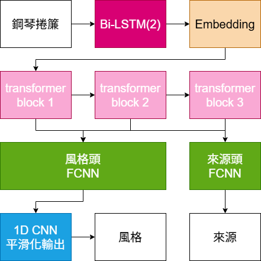
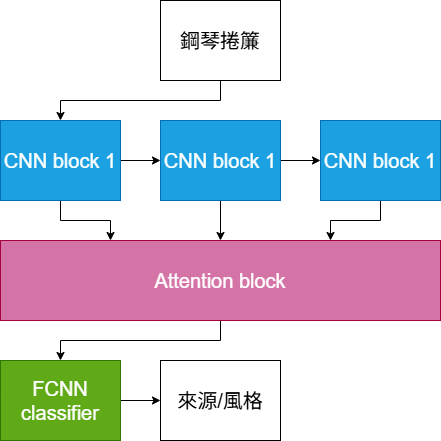
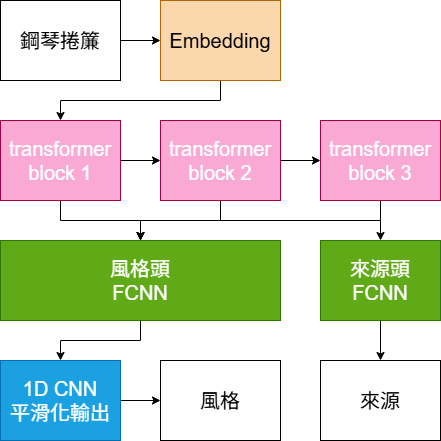
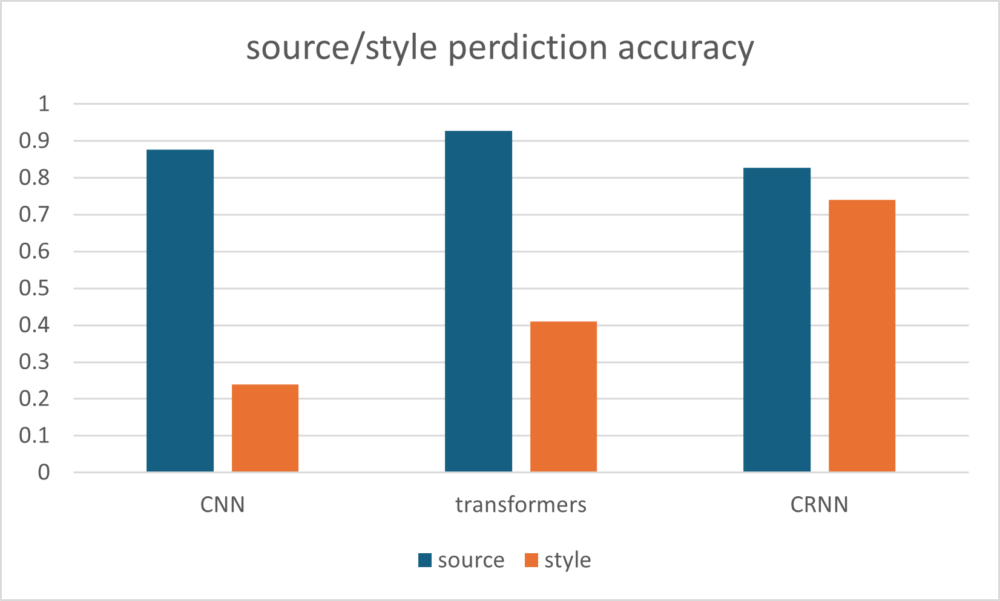
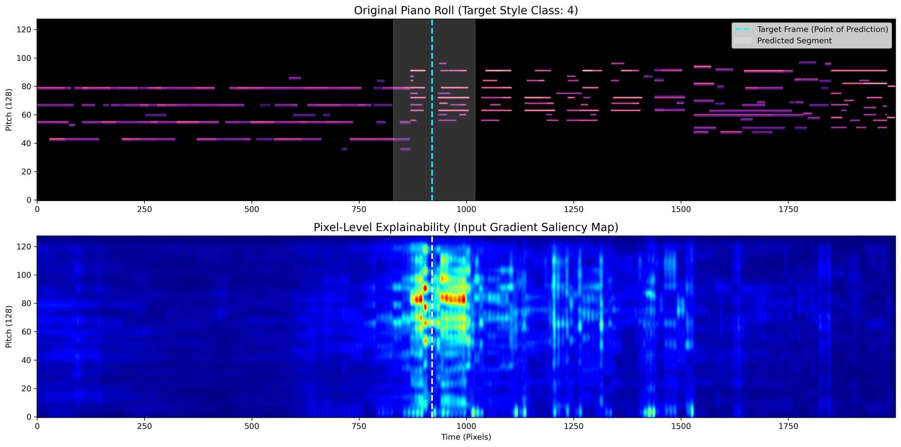
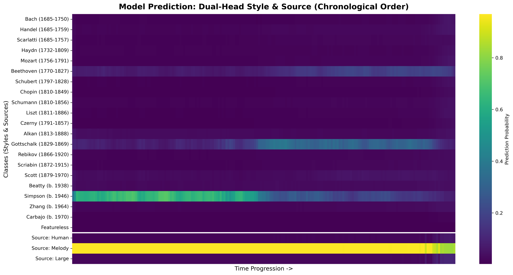
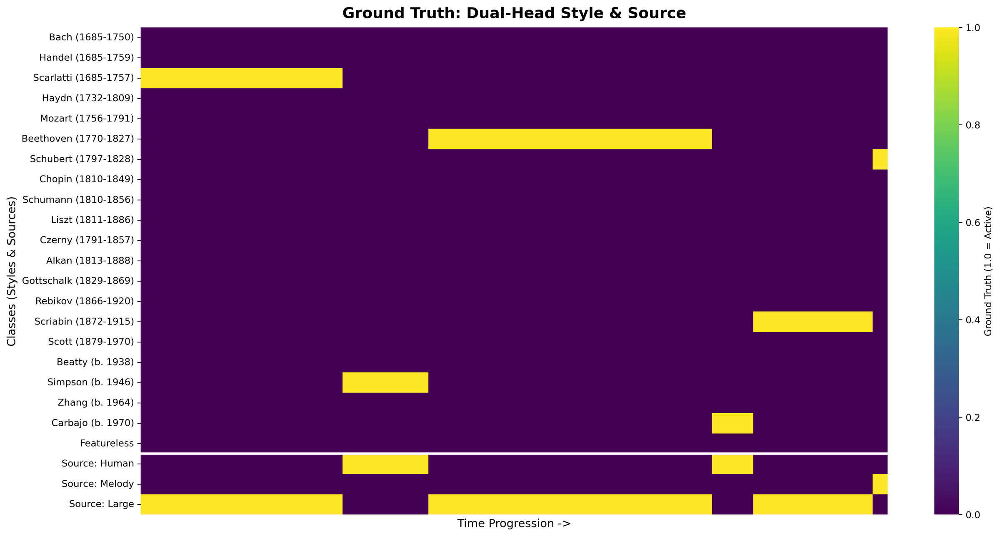

# MusicBrain：結合多標籤分類與可解釋性之 AI 生成音樂識別模型

> 第 66 屆高級中等學校科學展覽會 第 6 區｜電腦與資訊科學科｜高級中等學校組
> 作者：林君彥

MusicBrain 是一個端到端的 AI 生成音樂檢測（Machine-Generated Music Detection, MGMD）模型，以**鋼琴捲簾（Piano Roll）**為輸入，同時完成兩項任務：

1. **合成檢測（Source，3 類）**：人類原創 / MusicGen-Large / MusicGen-Melody
2. **風格歸因（Composer-Style，20+1 類）**：辨識作曲家與曲風，並透過梯度法熱圖提供可解釋性

📄 完整研究報告：[`docs/MusicBrain_report.pdf`](docs/MusicBrain_report.pdf)

## 模型架構

核心模型為 **時序雙頭 CRNN + Transformer**：

- **1D CNN**：128 個音高直接作為輸入通道，時間軸以 stride 10（0.1 秒）壓縮
- **Bi-LSTM（2 層）**：長距離時序覆蓋
- **Transformer Encoder（6 層）**：保留第 2、4、6 層輸出做多尺度特徵融合
- **雙頭輸出**：來源頭（3 類）＋ 風格頭（21 類），風格頭後接 1D 卷積時序平滑器

| CRNN（本研究） | CNN（對照） | AST（對照） |
|:---:|:---:|:---:|
|  |  |  |

詳細架構圖：[`figures/architecture/crnn_detail.png`](figures/architecture/crnn_detail.png)

## 實驗結果

| 任務 | 指標 | CNN | AST | **CRNN** |
|---|---|---|---|---|
| 合成檢測 | F1-score | 0.928 | 0.927 | 0.927 |
| 風格歸因 | F1-score | 0.2404 | 0.4193 | **0.7653** |



在第三方生成模型（MIDI-LLM、MusicGen-medium）的測試中，CRNN 的合成檢測 F1 可達 0.99，風格歸因亦維持最佳。詳細分類報告見 [`results/`](results/)。

### 可解釋性（梯度法 Saliency Map）

計算目標幀預測 logit 對輸入鋼琴捲簾的梯度，標示出促成預測的音符。以貝多芬作品為例，模型關注的區域集中在強力度與短促切音處，與其作曲特徵相符。



| 模型逐幀預測 | 真實標籤 |
|:---:|:---:|
|  |  |

## 專案結構

```
├── docs/                 研究報告（PDF）
├── src/
│   ├── crnn/             本研究模型：CRNN + Transformer
│   │   ├── train_stage1.py            第一階段：序列級別訓練
│   │   └── train_stage2_finetune.py   第二階段：逐幀（frame-by-frame）微調
│   ├── ast/              對照組：AST 架構 Transformer
│   └── cnn/              對照組：Attention ConvNeXt CNN
├── results/              各模型分類報告
└── figures/              架構圖、實驗圖表、可解釋性熱圖
```

## 使用方式

```bash
pip install -r requirements.txt

cd src/crnn
python train_stage1.py            # 序列級別訓練 → best_temporal_smooth_model.pth
python train_stage2_finetune.py   # 逐幀微調     → best_finetuned_source_model.pth
python eval.py
```

資料集預設路徑為 `../Datas`（可於各腳本的 `CONFIG['root_dir']` 修改）。資料集與模型權重因檔案過大未包含於本 repo。

## 資料集

- **人類原創**：[GiantMIDI-Piano](https://github.com/bytedance/GiantMIDI-Piano)（取數量最多的 20 組 Composer-Style，各 50 首）
- **AI 生成**：Meta [MusicGen](https://github.com/facebookresearch/audiocraft)（Melody 3.3B、Large 3.3B），使用與人類組相同的作曲家/風格提示詞生成

資料強化：節奏變速（0.8–1.2×）、力度縮放（0.7–1.3×）、八度平移與移調、隨機漏音（5%）。

## 參考文獻

- Silva et al. (2024). ArtBrain.
- Gong et al. (2021). AST: Audio Spectrogram Transformer.
- Copet et al. (2023). Simple and Controllable Music Generation (MusicGen).
- Raffel & Ellis (2014). pretty_midi.
